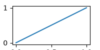

```{r}
#| label: fig-line
#| fig-cap: "A line with *emphasis*"
#| fig-width: 3
#| fig-height: 2
plot(1:3, type = "l")
```

{#fig-static}

| x | y |
|---|---|
| 1 | 2 |

: Numbers table {#tbl-nums}

See @fig-line, @fig-static and @tbl-nums.
